# 서울시 종로구·성북구 CCTV·보안등 공간 밀집도 분석

**서울시 종로구·성북구의 CCTV와 가로등(보안등) 위치 데이터를 활용한 공간적 밀집도 분석 및 행정동별 안전 인프라 편중 현황 연구**

2026-1학기 데이터시각화이해와실습 2팀 프로젝트(5인, A+)입니다.
범죄 데이터 없이도 CCTV와 보안등이 어디에 몰려 있고 어디가 비어 있는지 행정동 단위로 보여 주고, 두 시설이 모두 부족한 지역을 찾는 것이 목표였습니다.

- **내 역할:** 데이터 전처리·시각화 코드 작성, 회의록 정리
- **흐름:** 중간 보고서에서는 종로구만 분석했고, 기말에는 같은 방법을 성북구까지 넓혔습니다.

## 데이터

| 구 | 데이터 | 규모 |
|---|---|---|
| 종로구 | 종로구 CCTV 설치 현황 (종로구청) | 1,143개소 · 카메라 2,939대 (방범용 646개소) |
| 종로구 | 서울시 종로구 동별 보안등 현황 | 9,480개 → 이상 좌표 4개 제거 후 9,476개 |
| 성북구 | 성북구 CCTV 설치 현황 (성북구청) | 2,366개소 · 카메라 5,577대 |
| 성북구 | 서울시 안심귀갓길 안전시설물 (시설코드 305, 성북구) | 보안등 330개 (안심귀갓길 구간만 포함) |

CSV 파일은 공공데이터포털과 서울 열린데이터광장에서 받을 수 있습니다. 코드와 같은 폴더에 두고 실행합니다.
행정동 경계는 [vuski/admdongkor](https://github.com/vuski/admdongkor) GeoJSON을 사용했습니다.

## 전처리

- **종로구:** CCTV는 설치 목적이 '방범'인 646개소만 사용, 보안등은 위도 0 이하 이상 좌표 4개 제거
- **성북구:** CCTV는 성북구 범위를 벗어나는 좌표 제거 후 '생활방범'만 사용
- **성북구 보안등:** `POINT(경도 위도)` 형식의 WKT 문자열을 정규표현식으로 위도·경도로 분리, 시설코드 305(보안등)만 추출

## 시각화 6종 (구마다)

| | 종로구 | 성북구 |
|---|---|---|
| ① 설치 목적별 CCTV 카메라 대수 | 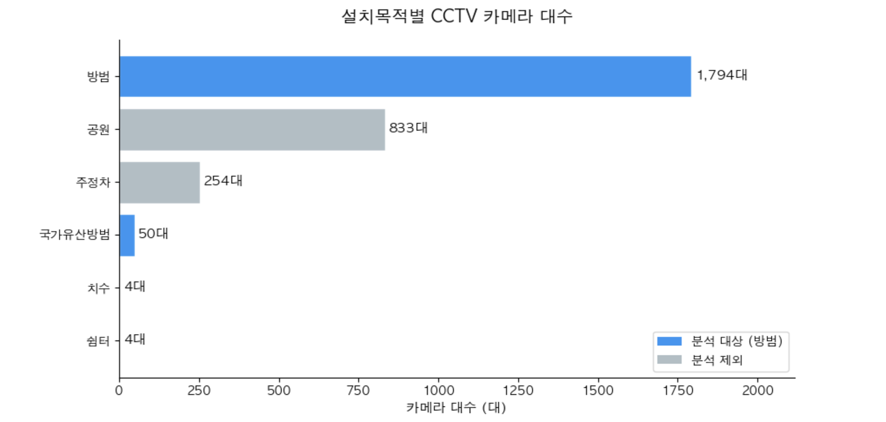 | 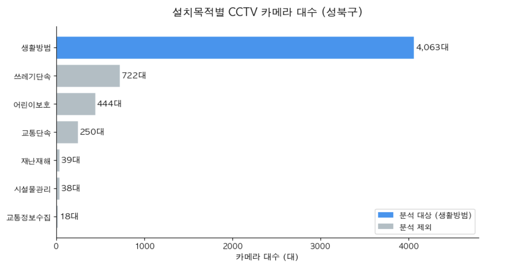 |
| ② 행정동별 보안등 수 | 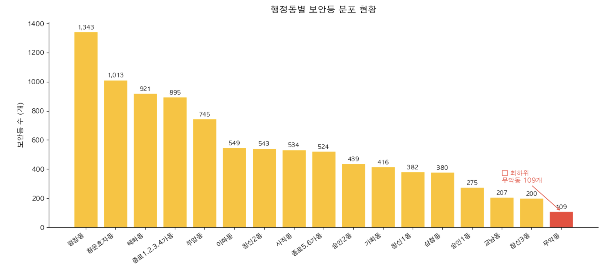 | 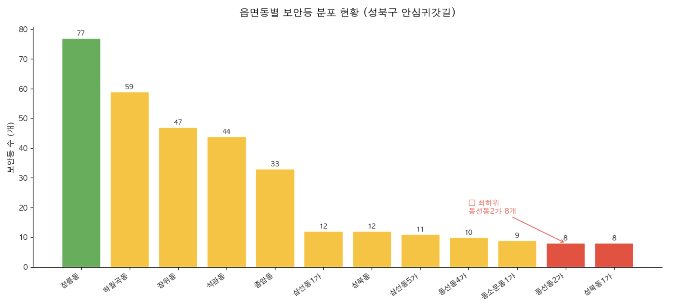 |
| ③ CCTV·보안등 위치 산점도 지도 (folium) | 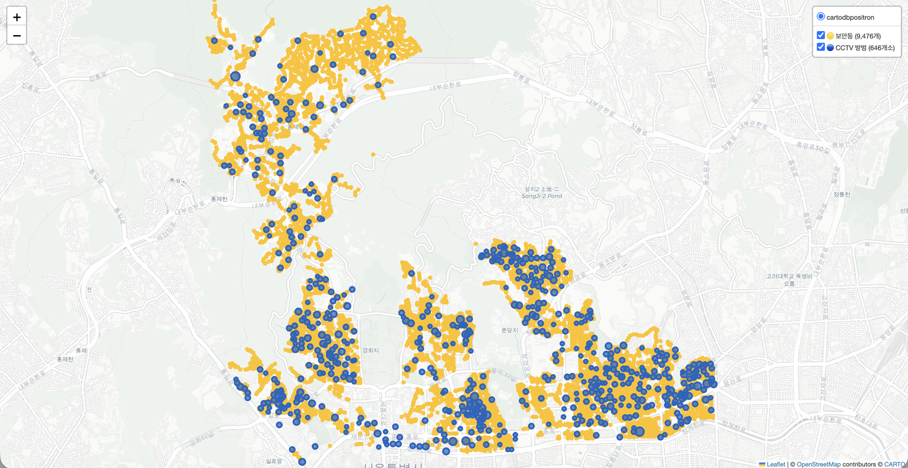 | 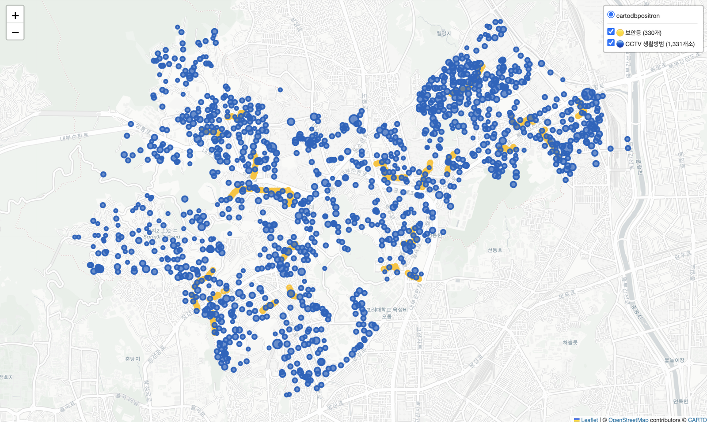 |
| ④ 행정동별 단계구분도 | 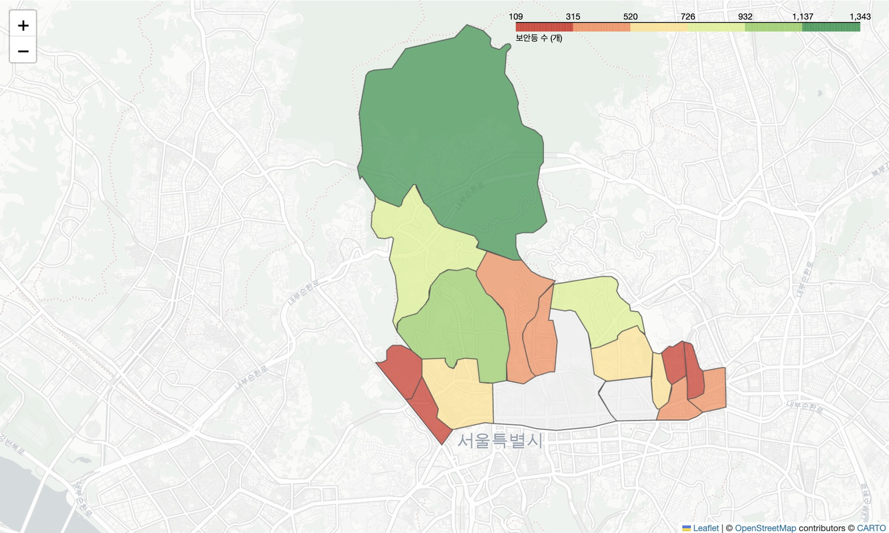 | 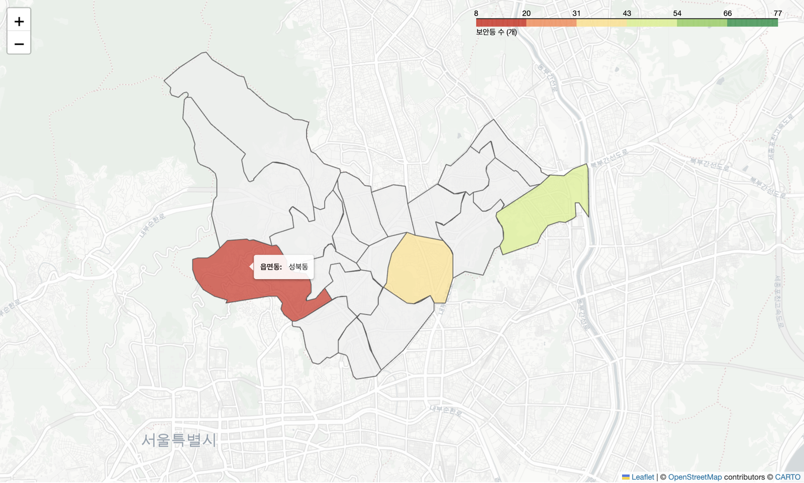 |
| ⑤ 인프라 편중 4분면 산점도 | 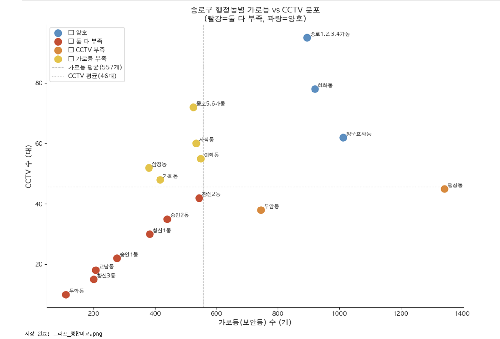 | 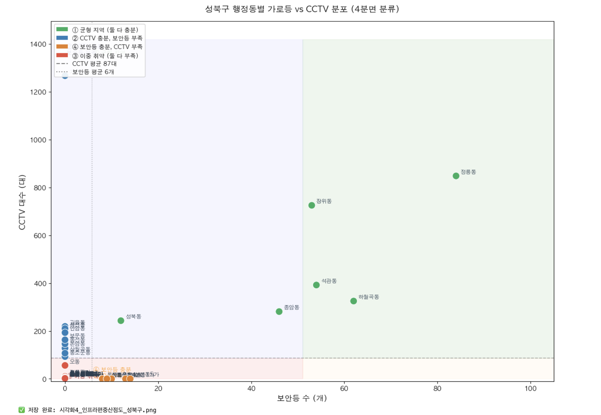 |
| ⑥ CCTV·보안등 결합 히트맵 | 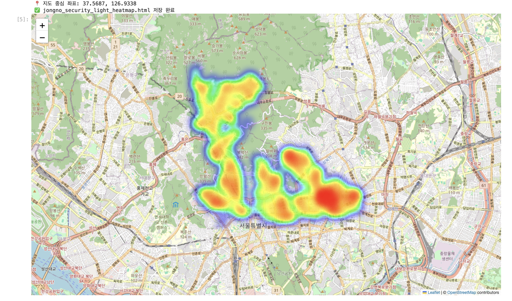 | 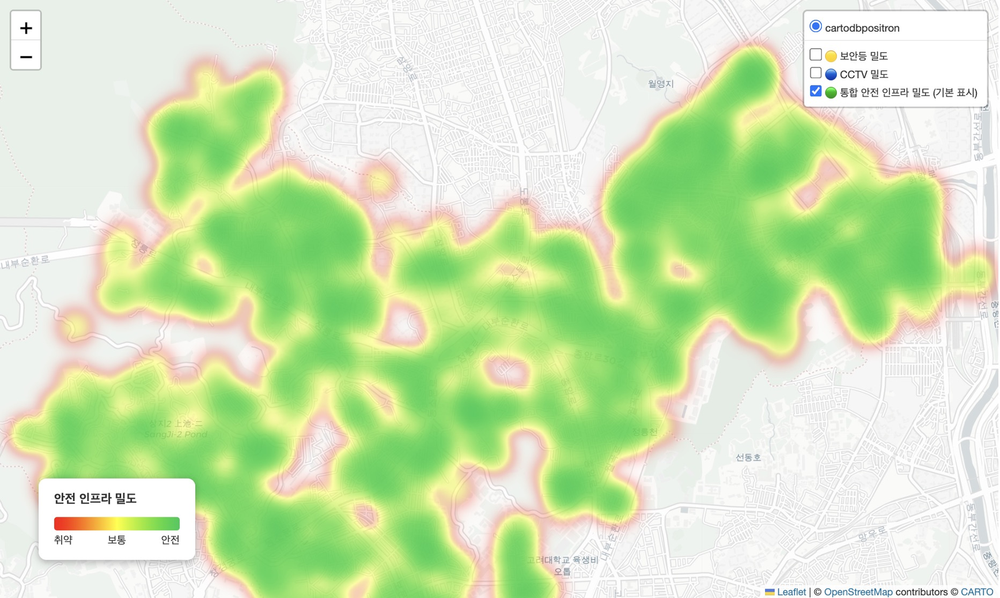 |

## 결과

- **종로구:** CCTV와 보안등이 모두 평균보다 적은 **이중 취약 지역 7개 동**(무악동·창신3동·교남동·숭인1동 등)을 찾았습니다. 혜화동·사직동 등 6개 동은 두 시설이 모두 충분한 균형 지역이었습니다.
- **성북구:** 동선동2가·동선동4가·동소문동1가·삼선동1가·삼선동5가·성북동1가 6개 동이 이중 취약으로 분류됐습니다. 다만 성북구 보안등 데이터는 안심귀갓길 구간만 담고 있어서, 이 결과는 "보안등이 없다"가 아니라 "현황을 알 수 없는 데이터 공백"이라는 한계를 함께 적었습니다.
- **보완 방안 (보고서에 구청 건의 형태로 제안):**
  - 무악동처럼 보안등이 평균의 절반도 안 되는 동은 노후 조명을 LED로 바꾼 뒤 보안등을 단계적으로 확대
  - 보안등은 충분하지만 CCTV가 적은 동(평창동·부암동, 정릉동·하월곡동)은 기존 보안등 전주에 지능형 기둥형 CCTV 설치
  - 성북구 서쪽 주거 밀집 지역은 안심귀갓길 추가 지정
  - 안전 인프라 밀도가 평균의 50% 미만인 동을 우선 설치 대상으로 지정

## 파일

```
jongno_viz.py                     종로구 전처리 + 시각화 ①~⑥
jongno_light_heatmap_midterm.py   중간 보고서 단계의 종로구 보안등 히트맵
sungbuk_data_check.py             성북구 데이터 확인 (초기 단계)
sungbuk_viz.py                    성북구 전처리 + 시각화 ①~⑤
images/                           보고서에 실린 결과 그림
```

- 코드는 최종 보고서에 실린 코드 화면을 그대로 옮겨 적었습니다.
- 4분면 산점도의 행정동별 집계표(`summary`, `cctv_by_dong`, `light_by_dong`)를 만드는 부분은 보고서에 실리지 않아 빠져 있습니다.
- 성북구 히트맵 코드도 보고서에 실리지 않아 그림만 넣었습니다.

## 실행 환경

Python 3, pandas, matplotlib, seaborn, folium, requests (Jupyter Notebook)

## 팀

신채윤(조장), 계은혜, 유한나, 김채영, 권성연
