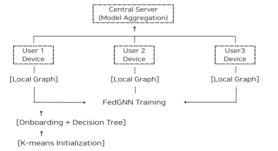
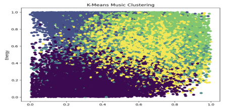
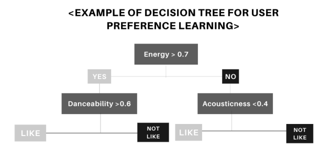

# KOD-FedGNN 기반 신규 사용자 음악 추천 시스템 개선 연구

2026-1학기 기계학습 Mini Research Project(5인)입니다.
이용 기록이 전혀 없는 신규 사용자에게도 첫 추천을 할 수 있도록(콜드스타트 완화), K-means 군집화·온보딩·의사결정나무·FedGNN을 묶은 **KOD-FedGNN**을 설계하고, 추천 파이프라인을 코드로 구현했습니다.

- **내 역할:** 조장 · 추천 파이프라인 코드 작성
- **데이터:** Spotify Tracks Dataset (Kaggle) — danceability, energy, tempo, valence, acousticness 오디오 피처



## 파이프라인 (`kod_fedgnn_pipeline.py`)

1. **전처리:** 오디오 피처를 숫자로 바꾸고 결측값 제거, 0~1 범위와 tempo 50~220 BPM 밖의 값 제거, MinMaxScaler 정규화
2. **K-means 군집화 (k=5):** 전체 곡을 음향 특성이 비슷한 5개 그룹으로 나눔
3. **온보딩:** 군집마다 2곡씩, 총 10곡을 신규 사용자에게 제시하고 좋아요(1)/관심 없음(0) 응답을 받음
4. **의사결정나무 (max_depth=4, min_samples_leaf=2):** 10곡의 응답으로 바로 학습해 전체 곡의 '좋아요' 확률 계산. 데이터가 적어 깊이를 제한해 과적합을 막음
5. **군집 유사도 (Sim):** 사용자가 가장 많이 좋아한 군집의 중심과 각 곡의 코사인 유사도
6. **곡 흐름 (Flow):** 기준 곡과 tempo·energy·valence 차이가 작을수록 높은 점수
7. **최종 점수:** `0.4 × 선호 점수 + 0.3 × 의사결정나무 확률 + 0.2 × 군집 유사도 + 0.1 × 곡 흐름`으로 Top-10 추천

| K-means 군집화 결과 | 의사결정나무 예시 |
|---|---|
|  |  |

## 한계 (보고서에도 적은 내용)

- **FedGNN은 실제 연합학습을 돌리지 않았습니다.** 파이프라인 전체가 동작하는지 확인하려고 FedGNN 예측값을 시뮬레이션 값(의사결정나무 확률과 군집 유사도의 가중합)으로 대체했습니다.
- **온보딩 응답은 실제 사용자 응답이 아니라 무작위로 만든 예시**입니다.
- 코드의 Precision@5는 계산 방법을 보여 주는 예시로, 실제 사용자 선호를 기준으로 한 성능 평가가 아닙니다.
- 보고서는 사용자 단계별로 가중치를 바꾸는 시나리오(예: 신규 사용자 α=0.0, β=0.5, γ=0.4, δ=0.1)를 제안했고, 코드는 그중 한 가지 고정 가중치로 실행한 예시입니다.

## 실행

```bash
pip install pandas numpy scikit-learn matplotlib
# Kaggle Spotify Tracks Dataset을 spotify_tracks.csv 이름으로 같은 폴더에 둡니다.
python kod_fedgnn_pipeline.py
```

## 팀

계은혜(조장), 김서현, 윤은서, 유선진, 이채연
